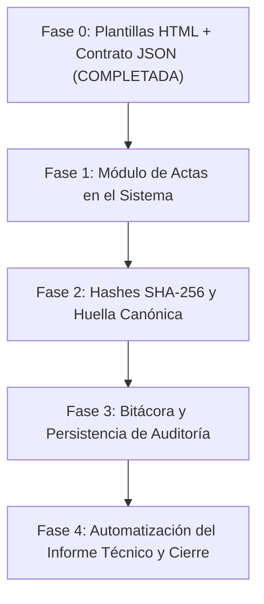

# Plan de Implementación: Suite de Actas e Informe Técnico (UNA-PUNO)

> **Origen:** Sesión del 14 de octubre de 2026 ([`analisis_actas.md`](file:///Users/angheloflores/.gemini/antigravity-cli/brain/05dd5754-c4e3-4bc4-b602-3c6e3dcfce01/analisis_actas.md)).  
> **Alcance:** Integración en el sistema web de las 5 actas y el informe técnico diseñados para el proceso de calificación.

---

## 1. La Suite Documental (6 Documentos)

| N.° | Documento | Momento Operativo | Firmantes |
|---|---|---|---|
| **01** | **Acta de Inicio y Apertura de Ambiente** | Previo al inicio de cómputo | Dir. Admisión + Pte. Comisión |
| **02** | **Acta de Recepción Digital** | Al recibir los archivos `.dat` y padrón | Responsable Cómputo + Entrega |
| **03** | **Acta de Recepción Física (+ Anexo Aulas)** | Al recibir los sobres lacrados por aula | Responsables de Recepción física |
| **04** | **Acta de Conformidad de Claves y Ponderaciones** | **Tras cargar claves y ANTES de calcular** | Jurado/Comisión + Técnico Cómputo |
| **05** | **Informe Técnico de Validación y Calificación** | Durante y al culminar el cálculo | Responsable Técnico de Cómputo |
| **06** | **Acta de Cierre y Conformidad Final** | Culminación y entrega de resultados | Dir. Admisión + Pte. Comisión |

---

## 2. Hoja de Ruta de Implementación

---

### Fase 0: Plantillas y Contrato de Datos (Estado: Completada ✅)
- [x] Maquetación HTML A4 de las 6 actas con CSS para impresión (`@page`, cortes limpios, bloques de firma fijos).
- [x] Contrato de datos [`datos-ejemplo.json`](file:///Users/angheloflores/dev/apps/calificadordad/reportes-actas/datos-ejemplo.json) con variables estandarizadas.
- [x] Visor interactivo [`visor.html`](file:///Users/angheloflores/dev/apps/calificadordad/reportes-actas/visor.html) y script de compilación a PDF en [`reportes-actas/`](file:///Users/angheloflores/dev/apps/calificadordad/reportes-actas).

---

### Fase 1: Módulo de Actas en la Aplicación
**Objetivo:** Permitir al usuario emitir e imprimir las actas directamente desde el sistema durante el flujo de calificación.

1. **Backend (`backend/actas/`):**
   * Crear nueva app Django `actas`.
   * Modelo `ActaDocumento`:
     * `proceso` (FK a `ProcesoCalificacion`).
     * `tipo` (`01_INICIO`, `02_REC_DIGITAL`, `03_REC_FISICA`, `04_CLAVES`, `05_INFORME`, `06_CIERRE`).
     * `correlativo` (ej. `CAL-2026-I-ACT01-001`).
     * `version` (entero, por defecto `1`).
     * `data_payload` (JSONField con la captura de datos automáticos y manuales).
     * `estado` (`BORRADOR`, `EMITIDA`, `ANULADA`).
     * `created_by` (aislamiento multi-usuario).
   * Endpoints REST para crear, listar, actualizar y emitir actas.
   * Actualizar [`backend/config/backup_views.py`](file:///Users/angheloflores/dev/apps/calificadordad/backend/config/backup_views.py) para incluir `ActaDocumento` en las copias de seguridad.

2. **Frontend:**
   * Nueva pestaña o sección contextual "Documentos y Actas" dentro de la vista del proceso.
   * Formulario para ingresar metadatos manuales que el sistema no posee (nombres de jurados, horas de apertura/cierre, ambiente, observaciones de lacre).
   * Montaje de la plantilla HTML con enlace reactivo a los datos del proceso actual.
   * Botón de impresión directa mediante `window.print()` con el CSS institucional.

---

### Fase 2: Huellas SHA-256 y Configuración Canónica
**Objetivo:** Garantizar la inmutabilidad y la trazabilidad criptográfica requerida por las actas 02, 04, 05 y 06.

1. **Hash de Archivos `.dat` y Padrón:**
   * En el frontend al cargar archivos en [`useArchives.js`](file:///Users/angheloflores/dev/apps/calificadordad/frontend/src/composables/useArchives.js), calcular el hash SHA-256 sobre los bytes originales utilizando `crypto.subtle.digest('SHA-256', buffer)`.
   * Almacenar el hash en los modelos `IdentifierSource`, `ResponseSource` y padrón.
   * Inyectar el hash automáticamente en el Acta 02.

2. **Huella Canónica de Claves y Ponderaciones:**
   * En [`frontend/src/domain/calification/`](file:///Users/angheloflores/dev/apps/calificadordad/frontend/src/domain/calification), implementar una función pura `computeConfigurationHash(answerKeys, ponderaciones)`.
   * Generar un JSON canónico ordenado de las claves (preguntas 1-N por área/tipo) y ponderaciones por materia, extrayendo su digest SHA-256.
   * Imprimir esta huella en el Acta 04.

---

### Fase 3: Bitácora de Eventos y Persistencia de Preflight
**Objetivo:** Alimentar la sección de incidencias y auditoría del Informe Técnico (Secciones 4.3, 4.6 y 4.7).

1. **Modelo `EventoBitacora`:**
   * Registro inmutable de eventos sensibles: cambio de clave post-carga, anulación de preguntas, edición de ponderación, reprocesamiento.
   * Campos: `proceso`, `usuario`, `timestamp`, `tipo_evento`, `descripcion`, `datos_anteriores`, `datos_nuevos`.

2. **Persistencia del Preflight y Validación:**
   * Guardar el resultado estructurado de [`preflight.js`](file:///Users/angheloflores/dev/apps/calificadordad/frontend/src/domain/calification/preflight.js) y [`validateResults.js`](file:///Users/angheloflores/dev/apps/calificadordad/frontend/src/domain/calification/validateResults.js) en la entidad `AreaCalificacion` o en el acta técnica al momento de ejecutar el cálculo.

---

### Fase 4: Automatización del Informe Técnico y Cierre
**Objetivo:** Completar el Informe Técnico (05) y el Acta de Cierre (06) sin requerir llenado manual.

1. **Pruebas Sintéticas de Dominio:**
   * Generar automáticamente en backend/frontend hojas de prueba sintéticas por cada tipo de examen (100% aciertos, 100% blancos, 100% errores) procesadas por `calculateResults` para validar la correspondencia esperada vs. calculada.
2. **Control de Inmutabilidad en Preflight:**
   * El preflight validará si la huella SHA-256 de las claves coincide exactamente con la registrada en el Acta 04 emitida. Si difiere, emitirá una alerta crítica de "Configuración alterada después de conformidad".
3. **Registro de Productos Finales:**
   * Cálculo de hash SHA-256 de los archivos Excel y PDF exportados ([`useExport.js`](file:///Users/angheloflores/dev/apps/calificadordad/frontend/src/composables/useExport.js)) para consignarlos automáticamente en el Acta de Cierre.
