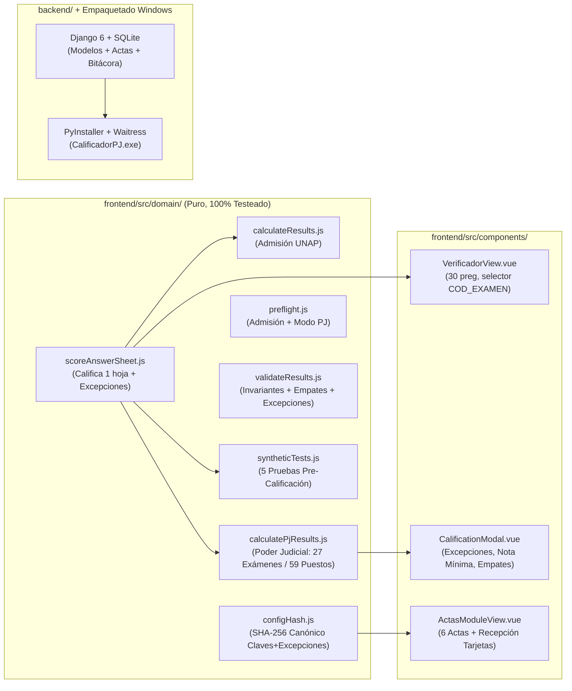

# PLAN MAESTRO DE IMPLEMENTACIÓN: CALIFICADOR PODER JUDICIAL (CSJ PUNO — UNA PUNO)

> **Rama de trabajo activa:** `feat/calificacion-pj` (creada desde `main` en `5e1d932`).  
> **Propósito de este documento:** Especificación técnica exhaustiva, determinista y paso a paso diseñada para que agentes de codificación implementen de principio a fin la adaptación del sistema Calificador DAD al **Proceso de Selección de Personal D.L. 728 N.° 001-2026-UE-PUNO (Corte Superior de Justicia de Puno — Poder Judicial)**, sin romper ningún flujo existente de Admisión UNAP.

---

## 1. CONTEXTO OPERATIVO Y DATOS VERIFICADOS DEL PROCESO

### 1.1 Datos Reales Extraídos de `calificacionPoderJudicial.rar`
- **Archivo contenedor:** `calificacionPoderJudicial.rar`
  - **SHA-256:** `eee7604f3025bdc93bc5ea5743a3663b83068fc9deaddc28dcf088c827bdf2e2`
- **Padrón Oficial:** `PLANTILLA_PARTICIPANTES_001-2026-UE-PUNO.xlsx`
  - **SHA-256:** `decf800172efcfdbbc15090eb5dbc67bebacd9303e3ef93a45cd4180db4dff92`
  - **Total registros:** `1,982` postulantes (todos con DNI válido y único de 8 dígitos).
  - **Columnas exactas (9):** `DNI`, `PATERNO`, `MATERNO`, `NOMBRES`, `COD_EXAMEN`, `COD_PUESTO`, `PUESTO`, `UNIDAD`, `OBSERVACIONES`.
  - **Códigos de Examen (`COD_EXAMEN`):** **27 códigos distintos**:
    - `E01a` (8), `E01b` (103), `E02a` (61), `E02b` (63), `E02c` (109), `E03a` (101), `E03b` (193), `E03c` (133), `E03d` (37), `E04a` (119), `E04b` (114), `E05` (178), `E06` (126), `E07` (26), `E08a` (44), `E08b` (39), `E09a` (50), `E09b` (67), `E09c` (17), `E09d` (37), `E10` (22), `E11` (145), `E12` (32), `E13` (32), `E14` (13), `E15` (62), `E16` (51).
  - **Puestos (`COD_PUESTO` / `PUESTO`):** **59 puestos únicos** para cubrir **65 vacantes**.
    - *Invariante verificada:* Cada `COD_PUESTO` pertenece exactamente a **un único `COD_EXAMEN`** y a **una única `UNIDAD`**. Un `COD_EXAMEN` puede evaluar a uno o varios `COD_PUESTO`.
  - **Grupos y Aulas (`OBSERVACIONES`):** Formato `"grupo X - aula AYY"`:
    - `grupo 1` (Turno Mañana): **998 postulantes** distribuidos en 25 aulas (`A01` a `A25`).
    - `grupo 2` (Turno Tarde): **984 postulantes** distribuidos en 25 aulas (`A01` a `A25`).
    - *Invariante verificada:* Cada `COD_EXAMEN` se rinde íntegramente en un único grupo.
- **Archivos `.dat` de Lectura Óptica (`test_ide_5964.dat` y `test_res_5964.dat`):**
  - Estructura de línea ID: `107000001001101526001   5310 #0001    N 243003R01234567789`
  - Estructura de línea RESP: `109000001001101526001   5310 #0001    N 243002 ABCDEDCBABCDEDCBABCDEDCBABCDED`
  - **Parámetros `DatFormatConfig` para PJ:**
    - `headerLength: 21`, `answersLength: 30`, `lithoOffset: 0`, `lithoLength: 6`, `tipoOffset: 6`, `tipoLength: 1`, `dniOffset: 7`, `dniLength: 8`, `aulaOffset: 15`, `aulaLength: 3`, `answersOffset: 18`, `responseAnswersOffset: 7`.
    - El parser actual (`frontend/src/utils/parsers.js`) **ya procesa exactamente este formato** cuando `answersLength = 30`.

### 1.2 Reglas de Negocio Confirmadas por el Usuario
1. **Puntuación por defecto (100% parametrizable en vivo):**
   - Correcta = `1.000` punto (modificable a `10`, `2`, etc. antes de calificar).
   - Incorrecta = `0.000` puntos (modificable si piden descuento).
   - Blanco = `0.000` puntos (modificable).
   - Marca múltiple (`*`) o carácter inválido = `0.000` puntos siempre.
   - Cantidad de preguntas = `30` (con peso unitario `1.0` por defecto, o ponderado por bloques si lo solicitan).
2. **Asociación de Claves Oficiales:**
   - Existe **1 clave oficial por cada `COD_EXAMEN`** (27 claves en total).
   - El campo `tipo` (`R`, vacío, etc.) que venga en el archivo `.dat` **se ignora** para buscar la clave en el modo Poder Judicial. El postulante se califica con la clave del `COD_EXAMEN` asignado a su DNI en el padrón oficial.
3. **Fuente de Aula y Grupo:**
   - El **Grupo** y **Aula oficial** del postulante se toman de la columna `OBSERVACIONES` del padrón (`grupo 1 - aula A18`). El aula numérica leída en el `.dat` (`789`, `102`) se conserva como metadato de lectura óptica (`aula_dat`) sin invalidar ni bloquear al postulante.
4. **Criterio de Resultados, Nota Mínima, Vacantes y Empates:**
   - El sistema debe ofrecer **configuración dual** en el modal de calificación y en la vista de resultados:
     1. **Corte por Vacantes del Puesto (`cupo`):** marca `isIngresante = true` hasta cubrir las vacantes del puesto (total 65 vacantes en los 59 puestos).
     2. **Corte por Nota Mínima Aprobatoria (`minPassingScore` opcional, activable con checkbox):** marca condición `APTO / APROBADO` si `score >= minPassingScore` y `NO APTO / DESAPROBADO` en caso contrario. Ambos modos pueden usarse juntos (ej. requiere nota mínima Y estar dentro del cupo) o por separado (solo ranking + nota mínima).
   - **Gestión de Empates:**
     - El motor debe **detectar automáticamente todos los empates de puntaje** dentro de cada `COD_PUESTO` (marcando flag `isTied: true`, `tieGroupSize`, y flag crítico `isCutoffTie: true` cuando el empate ocurre exactamente en la última vacante del puesto).
     - El usuario puede elegir en la UI la regla de resolución de empates:
       - `shared_rank`: Posición compartida (ej. ambos en puesto 1, el siguiente es puesto 3) y si empatan en el corte de vacante, ambos se marcan como `EMPATE EN CORTE` para decisión de la comisión.
       - `fewer_incorrect`: Desempata quien tenga más aciertos / menos errores.
       - `alphabetical`: Desempata por orden alfabético (`paterno`, `materno`, `nombres`, `dni`).
5. **Sistema de Excepciones (Preguntas y Postulantes):**
   - **Excepción Tipo 1 — Pregunta Anulada (Puntaje para todos — `ANULADA_OTORGAR`):** Todos los postulantes que rinden ese `COD_EXAMEN` reciben el puntaje completo de la pregunta (`correctValue * weight`), hayan marcado cualquier letra, blanco o `*`.
   - **Excepción Tipo 2 — Pregunta Anulada (Excluida del cálculo — `ANULADA_EXCLUIR`):** La pregunta aporta `0` puntos para todos y se descuenta del puntaje máximo posible del examen.
   - **Excepción Tipo 3 — Múltiples Claves Válidas (`CLAVE_MULTIPLE`):** Permite definir un conjunto de letras válidas (ej. `"BD"`) para una pregunta específica de un `COD_EXAMEN`. Si el postulante marcó cualquiera de ellas, es `correct`.
   - **Excepción Tipo 4 — Anulación de Participación de Postulante (`POSTULANTE_ANULADO`):** Dado un `dni`, motivo y documento/acta de sustento, el postulante no entra al cuadro de méritos y pasa a la lista auditada de `Anulados por Comisión` con estado explícito.

---

## 2. ARQUITECTURA DE LA SOLUCIÓN (RESPETANDO REGLAS DE `AGENTS.md`)



### Reglas Inquebrantables para el Agente Codificador
1. **No romper Admisión:** Los `processType` existentes (`simulacro`, `real`) deben seguir pasando el 100% de los tests actuales sin cambiar su comportamiento. Se introduce el modo `processType === 'poder_judicial'` (o seleccionable al crear proceso como **"Concurso Poder Judicial (Por Código de Examen y Puesto)"**).
2. **Lógica de calificación solo en `frontend/src/domain/calification/`:** Ningún componente Vue ni el verificador manual pueden calcular puntajes con fórmulas propias; todos deben invocar `scoreAnswerSheet()`.
3. **API/BD como fuente de verdad:** Prohibido guardar tablas de negocio en `localStorage`.
4. **Aislamiento `created_by`:** Todo nuevo modelo operativo lleva `created_by` y se incluye en `backend/config/backup_views.py`.

---

## 3. FASES DE IMPLEMENTACIÓN DETALLADAS

---

### FASE 1: Esquema de Padrón PJ, Formato DAT 30 Preguntas y Hashes SHA-256 de Archivos

#### 1.1 Backend (`backend/convocatorias/`)
1. **Archivo:** `backend/convocatorias/models.py`
   - En `Candidato`: agregar campos opcionales con `blank=True, default=''`:
     - `cod_examen = models.CharField(max_length=30, blank=True, default='')`
     - `cod_puesto = models.CharField(max_length=30, blank=True, default='')`
     - `puesto = models.CharField(max_length=200, blank=True, default='')`
     - `unidad = models.CharField(max_length=250, blank=True, default='')`
     - `grupo = models.CharField(max_length=50, blank=True, default='')`
     - `aula_padron = models.CharField(max_length=50, blank=True, default='')`
   - En `IdentifierSource`, `ResponseSource`, `AnswerKeySource`:
     - Agregar `sha256 = models.CharField(max_length=64, blank=True, default='')`
     - Agregar `file_size = models.IntegerField(default=0)`
   - Crear modelo `ArchiveSourceMeta(models.Model)` (o guardar en configuración del proceso) para registrar el nombre, tamaño y `sha256` del archivo Excel del padrón (`PLANTILLA_PARTICIPANTES_001-2026-UE-PUNO.xlsx`) y del archivo contenedor `.rar` (`calificacionPoderJudicial.rar`).
2. **Migración:** Generar `backend/convocatorias/migrations/0012_pj_fields_and_sha256.py`.
3. **Serializers y Backup:**
   - Actualizar `backend/convocatorias/serializers.py` y `backend/config/backup_views.py` para incluir los nuevos campos.

#### 1.2 Frontend (`frontend/src/constants/index.js` y `frontend/src/composables/useArchives.js`)
1. **Mapeo automático del Excel PJ en `ARCHIVE_SCHEMA_FIELDS` y `ARCHIVE_KEY_ALIASES`:**
   - Agregar `cod_examen`, `cod_puesto`, `puesto`, `unidad`, `grupo`, `aula_padron` a `ARCHIVE_SCHEMA_FIELDS`.
   - En `ARCHIVE_KEY_ALIASES`:
     - `cod_examen: ['cod_examen', 'cod examen', 'codigo examen', 'código examen', 'examen']`
     - `cod_puesto: ['cod_puesto', 'cod puesto', 'codigo puesto', 'código puesto']`
     - `puesto: ['puesto', 'cargo', 'plaza', 'denominacion del puesto']`
     - `unidad: ['unidad', 'dependencia', 'organo jurisdiccional', 'sede']`
   - En `mapArchiveRowToSchema(row)` (`useArchives.js`):
     - Si viene `cod_examen` (ej. `E02a`) y `area` está vacía (y `cod_examen` no es `'1'`, `'2'`, `'3'`), asignar `mappedRow.area = mappedRow.cod_examen`.
     - Si viene `puesto` y `programa` está vacío, asignar `mappedRow.programa = mappedRow.puesto`.
     - Si viene `cod_puesto` y `codigo_programa` está vacío, asignar `mappedRow.codigo_programa = mappedRow.cod_puesto`.
     - Parsear `observaciones` con regex `/grupo\s*(\d+)\s*-\s*aula\s*([A-Za-z0-9]+)/i`: si hace match, poblar `grupo = "Grupo " + match[1]` y `aula_padron = match[2].toUpperCase()`.
2. **Utilidad SHA-256 (`frontend/src/utils/cryptoHash.js`):**
   - Implementar `computeFileSha256(fileOrArrayBuffer)` usando `crypto.subtle.digest('SHA-256', buffer)` con fallback puro en JS (para entornos sin contexto seguro o tests en Node/jsdom) que devuelva el hex string de 64 caracteres en minúsculas.
   - Calcular automáticamente el `sha256` al importar el padrón Excel, al importar `.dat` de Identificadores/Respuestas/Claves, y permitir calcular el `sha256` de un archivo `.rar`/`.zip` en la pestaña de Recepción Digital.
3. **Preset de Formato DAT para Poder Judicial:**
   - En `ConfigView.vue` y `useDatFormat.js`: agregar botón rápido **"Aplicar Preset Poder Judicial (30 preguntas)"** que establece `answersLength = 30`, `headerLength = 21` y crea automáticamente la plantilla base `"Poder Judicial — 30 Preguntas"` (1 ítem de 30 preguntas con ponderación `1.0`).

---

### FASE 2: Motor de Dominio Unificado, Modo Poder Judicial, Excepciones, Empates y 5 Pruebas Sintéticas

#### 2.1 Función Pura de Calificación Individual (`frontend/src/domain/calification/scoreAnswerSheet.js`)
Crear este módulo como **única fuente de verdad matemática** para calificar una hoja de respuestas:

```javascript
/**
 * Califica una hoja de respuestas contra una clave oficial aplicando el plan de preguntas y excepciones.
 * @param {Object} params
 * @param {string} params.answersRaw - Cadena de respuestas del postulante
 * @param {string} params.correctAnswersRaw - Cadena de clave oficial
 * @param {Array<{subject: string, weight: number}>} params.plan - Plan por pregunta (longitud = answersLength)
 * @param {number} params.correctValue - Valor por acierto (default PJ: 1)
 * @param {number} params.incorrectValue - Valor por desacierto (default PJ: 0)
 * @param {number} params.blankValue - Valor por blanco (default PJ: 0)
 * @param {Array<Object>} [params.questionExceptions=[]] - Excepciones por número de pregunta (1-indexed)
 *   Cada excepción: { questionNumber, type: 'ANULADA_OTORGAR' | 'ANULADA_EXCLUIR' | 'CLAVE_MULTIPLE', validAnswers: 'BD', reason: '...' }
 * @returns {{
 *   score: number,
 *   maxPossibleScore: number,
 *   correctCount: number,
 *   incorrectCount: number,
 *   blankCount: number,
 *   multipleCount: number,
 *   annulledGrantedCount: number,
 *   annulledExcludedCount: number,
 *   questionDetails: Array<Object>,
 *   subjectBreakdown: Array<Object>,
 *   answersNormalized: string,
 *   correctAnswersNormalized: string,
 * }}
 */
export function scoreAnswerSheet({ ... })
```

**Reglas exactas dentro de `scoreAnswerSheet`:**
- Para cada pregunta `q = 1 .. plan.length`:
  - Buscar si existe excepción activa para `questionNumber === q`.
  - Si `exception.type === 'ANULADA_OTORGAR'`:
    - `contribution = correctValue * weight`
    - `status = 'correct'` (con `exceptionApplied: 'ANULADA_OTORGAR'`)
    - Suma a `maxPossibleScore`.
  - Si `exception.type === 'ANULADA_EXCLUIR'`:
    - `contribution = 0`
    - `status = 'excluded'` (con `exceptionApplied: 'ANULADA_EXCLUIR'`)
    - **No** suma a `maxPossibleScore`.
  - Si `exception.type === 'CLAVE_MULTIPLE'`:
    - `validSet = new Set(String(exception.validAnswers || correctChar).toUpperCase().replace(/[^A-E]/g, '').split(''))`
    - Si `isResponseCharValid && validSet.has(responseChar)` -> `contribution = correctValue * weight`, `status = 'correct'`.
    - Si `isResponseCharValid && !validSet.has(responseChar)` -> `contribution = incorrectValue * weight`, `status = 'incorrect'`.
    - Si `isMultipleMark` (`*`) -> `contribution = 0`, `status = 'multiple'`.
    - Si blanco -> `contribution = blankValue * weight`, `status = 'blank'`.
  - Sin excepción: comportamiento estándar idéntico al actual.
- Refactorizar `calculateAreaResults` en `calculateResults.js` para que use `scoreAnswerSheet` internamente, verificando que los tests existentes de Admisión pasen sin cambios.

#### 2.2 Motor de Calificación Poder Judicial (`frontend/src/domain/calification/calculatePjResults.js`)
Crear `calculatePjResults` para cuando `processType === 'poder_judicial'`:
- **Entradas:**
  - `archiveRows` (los 1,982 postulantes del padrón).
  - `responsesRows` y `responsesByDni`.
  - `answerKeyRows` (las 27 claves asociadas por `cod_examen` o `area`).
  - `plantilla` (30 preguntas), `correctValue` (default `1`), `incorrectValue` (default `0`), `blankValue` (default `0`), `answersLength` (`30`).
  - `questionExceptions`: lista de excepciones por `{ codExamen, questionNumber, type, validAnswers, reason, documentRef }`.
  - `candidateExceptions`: lista de postulantes anulados por `{ dni, reason, documentRef }`.
  - `vacantesPuesto`: mapa `{ [codPuesto_o_puesto]: number }` (suma = 65 vacantes, configurable).
  - `scoringOptions`: `{ useMinPassingScore: boolean, minPassingScore: number, requireQuotaForIngreso: boolean, tieBreakerMode: 'shared_rank' | 'fewer_incorrect' | 'alphabetical' }`.
- **Flujo de procesamiento por candidato:**
  1. Si el DNI está en `candidateExceptions`:
     - No entra a `results`. Se agrega a `anuladosComision` (y a `noCalificados` con `motivo: 'Participación anulada por comisión'`, `detalle: exception.reason`, `documento: exception.documentRef`).
  2. Si tiene problema de DNI (`getCandidateDniIssue`) o no tiene `cod_examen`/`puesto`:
     - Pasa a `noCalificados`.
  3. Si no tiene hoja de respuesta en `responsesByDni`:
     - Pasa a `noCalificados` con `motivo: 'Ausente / Sin respuesta .dat'`.
  4. Si tiene más de 1 hoja de respuesta para el mismo DNI:
     - Pasa a `noCalificados` con `motivo: 'Respuesta duplicada'`.
  5. Busca la clave oficial exclusivamente por `codExamen = candidate.cod_examen || candidate.area` (**ignorando `row.tipo` del `.dat`**). Si no existe clave para ese `codExamen`:
     - Pasa a `noCalificados` con `motivo: 'Sin clave para código de examen'`.
  6. Invoca `scoreAnswerSheet` pasando las `questionExceptions` que apliquen a ese `codExamen` (o globales `*`).
  7. Asigna `aula = candidate.aula_padron || responseRow.aula`, `grupo = candidate.grupo`, `aulaDat = responseRow.aula`, `codExamen`, `codPuesto`, `puesto`, `unidad`.
- **Agrupación por Puesto, Empates, Nota Mínima y Vacantes:**
  - Agrupar `processedResults` por `codPuesto || programa`.
  - Ordenar según `tieBreakerMode`:
    - Siempre primero por `score` descendente.
    - Si `tieBreakerMode === 'fewer_incorrect'`: desempatar por `correctCount` descendente, luego `incorrectCount` ascendente.
    - Si `tieBreakerMode === 'alphabetical'`: desempatar por nombre completo y DNI.
    - Si `tieBreakerMode === 'shared_rank'`: ordenar visualmente por apellido, pero asignar **la misma `positionInPrograma`** (compartida) a quienes tengan exactamente el mismo `score`.
  - Detectar empates en cada puesto:
    - Contar cuántos candidatos comparten el mismo `score` en el mismo puesto. Si `count > 1`, marcar `isTied = true`, `tieCount = count`.
    - Si el empate ocurre en el puntaje del último cupo del puesto (`cupo > 0`), marcar `isCutoffTie = true` y registrar el caso en `summary.tiesAtCutoff` para alertar a la comisión.
  - Condición `isApto` y `isIngresante`:
    - `isApto = scoringOptions.useMinPassingScore ? (r.score >= scoringOptions.minPassingScore) : true`.
    - `isIngresante = isApto && (cupo > 0 ? r.positionInPrograma <= cupo : scoringOptions.useMinPassingScore && isApto)`.
    - Estado textual `condicion`:
      - Si `isCutoffTie && isApto`: `'EMPATE EN CORTE'`
      - Si `isIngresante`: `'GANADOR / ALCANZÓ VACANTE'` (o `'APROBADO'` si no se usan cupos)
      - Si `isApto && !isIngresante`: `'APROBADO (SIN VACANTE)'` (o `'ELEGIBLE'`)
      - Si `!isApto`: `'NO APROBADO'`

#### 2.3 Generador de las 5 Pruebas Sintéticas Pre-Calificación (`frontend/src/domain/calification/syntheticTests.js`)
Implementar `runPreCalificationSyntheticSuite({ answerKeyRows, plantilla, correctValue, incorrectValue, blankValue, answersLength, questionExceptions, sampleExamCode })`:
Ejecuta usando `calculatePjResults` / `scoreAnswerSheet` los **5 casos obligatorios del protocolo PJ**:
1. **`ALL_CORRECT` (Todas Correctas):** Genera una hoja sintética idéntica a la clave oficial del `sampleExamCode`. Verifica que `score === maxPossibleScore` (ej. `30.000` con valor `1` o `300.000` con valor `10`) y `correctCount === 30`.
2. **`ALL_INCORRECT` (Todas Incorrectas):** Genera una hoja sintética donde cada posición `i` tiene la letra siguiente en el ciclo `A->B->C->D->E->A` respecto a la clave oficial. Verifica que `correctCount === 0`, `incorrectCount === 30` y `score === 30 * incorrectValue`.
3. **`ALL_BLANK` (Todas en Blanco):** Genera una hoja de 30 espacios `' '`. Verifica que `blankCount === 30` y `score === 30 * blankValue`.
4. **`WITH_EXCEPTIONS` (1 Tipo de Examen con Excepciones):** Toma las excepciones configuradas (o simula 1 pregunta `ANULADA_OTORGAR` y 1 `CLAVE_MULTIPLE` si aún no hay excepciones reales) y verifica que una hoja en blanco/alternativa reciba exactamente el puntaje de la pregunta anulada y la clave múltiple.
5. **`CANDIDATE_ANNULMENT` (Prueba de Anulación de Participación a un Postulante):** Ejecuta una corrida con un postulante sintético `DNI 99999999` incluido en `candidateExceptions` y verifica que no aparezca en el ranking de calificados y figure en `anuladosComision` con su justificación.

Devuelve un objeto auditado `{ passedAll: boolean, executedAt: ISOString, cases: [...] }` listo para imprimirse en el Acta 04 y en el Informe Técnico 05.

#### 2.4 Huella Criptográfica Canónica (`frontend/src/domain/calification/configHash.js`)
Implementar `buildCanonicalConfigurationPayload(...)` y `computeConfigurationSha256(...)`:
- Serializa de forma determinista (claves de objeto ordenadas alfabéticamente):
  - `answersLength`, `correctValue`, `incorrectValue`, `blankValue`, `plantillaItems`,
  - `answerKeys`: lista ordenada por `codExamen` (`E01a` .. `E16`) con `{ codExamen, answers }`,
  - `questionExceptions`: lista ordenada por `codExamen, questionNumber`,
  - `candidateExceptions`: lista ordenada por `dni`.
- Calcula el SHA-256 sobre el string JSON canónico y devuelve el hash de 64 caracteres y su formato en bloques de 8 (`1157033E FDF632A7 ...`).

---

### FASE 3: Módulo de Excepciones, Bitácora de Modificaciones y Preflight PJ

1. **Backend (`backend/resultados/models.py`):**
   - En `ProcesoCalificacion`:
     - Permitir `process_type = 'poder_judicial'`.
     - Agregar `config_metadata = models.JSONField(default=dict, blank=True)` para almacenar:
       - `rar_sha256`, `rar_filename`, `padron_sha256`, `padron_filename`,
       - `question_exceptions` (lista JSON),
       - `candidate_exceptions` (lista JSON),
       - `scoring_options` (`useMinPassingScore`, `minPassingScore`, `tieBreakerMode`),
       - `approved_config_sha256` (huella firmada en el Acta 04),
       - `synthetic_tests_snapshot` (resultado de las 5 pruebas sintéticas).
   - En `AreaCalificacion`:
     - Agregar `preflight_snapshot = models.JSONField(default=dict, blank=True)`
     - Agregar `validation_snapshot = models.JSONField(default=dict, blank=True)`
     - Agregar `config_sha256 = models.CharField(max_length=64, blank=True, default='')`
   - Nuevo modelo `EventoBitacora(models.Model)`:
     - `proceso = models.ForeignKey(ProcesoCalificacion, on_delete=models.CASCADE, related_name='bitacora')`
     - `created_by = models.ForeignKey(User, on_delete=models.PROTECT)`
     - `timestamp = models.DateTimeField(auto_now_add=True)`
     - `categoria = models.CharField(max_length=40)` (`CLAVE`, `PONDERACION`, `EXCEPCION_PREGUNTA`, `ANULACION_POSTULANTE`, `EDICION_FILA`, `RECALCULO`)
     - `accion = models.CharField(max_length=200)`
     - `justificacion = models.TextField(blank=True)`
     - `documento_sustento = models.CharField(max_length=150, blank=True)`
     - `valor_anterior = models.JSONField(null=True, blank=True)`
     - `valor_nuevo = models.JSONField(null=True, blank=True)`
2. **UI de Excepciones y Reglas PJ en `CalificationModal.vue` y `AnswerKeysTab.vue`:**
   - En **Paso 4 (Claves de respuestas)** cuando el proceso es `poder_judicial`:
     - La columna `Área` se titula **`Código de Examen (COD_EXAMEN)`** con selector de los 27 códigos detectados en el padrón (`E01a` .. `E16`).
     - Indicador de progreso: **`X / 27 claves de examen cargadas`** (muestra chips con los códigos que faltan).
     - Importador rápido de claves desde Excel/CSV o pegado masivo (`COD_EXAMEN | 30 respuestas`).
   - En **Paso 5 (`CalificationModal.vue`)**:
     - Pestaña/Acordeón **"Excepciones y Fe de Erratas"**:
       - Agregar excepción de pregunta: elegir `COD_EXAMEN` (o `TODOS`), `N° Pregunta (1-30)`, tipo (`Anulada - Otorgar puntaje a todos`, `Anulada - Excluir pregunta`, `Múltiples claves válidas`), letras válidas, motivo y documento de sustento.
       - Agregar anulación de postulante: buscar por `DNI` (autocompleta nombre, puesto y examen desde el padrón), ingresar motivo y documento/acta de sustento.
     - Pestaña/Acordeón **"Criterios de Aprobación, Vacantes y Empates"**:
       - Inputs de puntaje: Correcta (`1`), Incorrecta (`0`), Blanco (`0`).
       - Toggle `Aplicar nota mínima aprobatoria` + input numérico (`minPassingScore`).
       - Selector de resolución de empates (`Posición compartida`, `Menor cantidad de incorrectas`, `Orden alfabético`).
     - Botón **"Ejecutar 5 Pruebas Sintéticas Pre-Calificación"** que muestra en tabla el check verde de las 5 pruebas exigidas por el PJ antes de habilitar o ejecutar la calificación general.

---

### FASE 4: Optimización del Verificador Manual para 30 Preguntas y Poder Judicial

**Archivos:** `frontend/src/components/views/VerificadorView.vue` y `frontend/src/composables/useVerificador.js`

1. **Unificación con el motor de dominio:**
   - Eliminar el bucle manual de cálculo en `VerificadorView.vue` (líneas 84-130) y reemplazarlo por una llamada reactiva a `scoreAnswerSheet()` de `frontend/src/domain/calification/scoreAnswerSheet.js`.
   - De este modo, el verificador manual respeta las **excepciones por pregunta** (`ANULADA_OTORGAR`, `ANULADA_EXCLUIR`, `CLAVE_MULTIPLE`) y produce al milésimo el mismo resultado que el motor masivo.
2. **Modo 30 Preguntas y Selector de `COD_EXAMEN`:**
   - Botón conmutador rápido en la barra superior del verificador: **`30 preguntas (Poder Judicial)`** / **`60 preguntas (Admisión)`**.
   - Por defecto en modo PJ:
     - `correctValue = 1`, `incorrectValue = 0`, `blankValue = 0`.
     - Cuadrícula visual organizada en **3 bloques de 10 preguntas** (`01–10`, `11–20`, `21–30`), cómoda en una sola vista sin scroll innecesario.
   - **Selector de `COD_EXAMEN` (`E01a` .. `E16`):**
     - Al elegir un código de examen, rellena automáticamente las 30 celdas de la clave oficial cargada en el proceso y aplica las excepciones activas de ese examen (mostrando insignia en las preguntas con excepción).
3. **Búsqueda Instantánea por DNI del Postulante:**
   - Al escribir un DNI en el verificador y presionar Enter / "Cargar del proceso":
     - Completa automáticamente: Nombre completo, `COD_EXAMEN`, `COD_PUESTO`, `PUESTO`, `UNIDAD`, `Grupo` y `Aula` desde el padrón.
     - Carga su cadena de 30 respuestas leída del `.dat` y la clave oficial de su `COD_EXAMEN`.
     - Muestra una banda de verificación cruzada: **`Puntaje en Verificador: XX.XXX` vs `Puntaje en Ranking Oficial: XX.XXX` — `COINCIDE 100% ✅`**.
4. **Reporte PDF Individual de Verificación Manual:**
   - Ajustar el PDF del verificador para que en exámenes de 30 preguntas imprima en 1 sola página A4 con los 3 bloques de 10 preguntas, las excepciones aplicadas y espacio de firmas.

---

### FASE 5: Suite de Actas Oficiales, Hoja de Recepción por Aula y Reportes de Publicación

Siguiendo exactamente el flujo operativo de `0. acta de inicio y abrir ambiente.txt`, `modelo.jpeg` y `reportes-actas/`:

| N.° | Documento / Reporte Imprimible (A4 / PDF) | Datos Automáticos Inyectados desde el Sistema |
|---|---|---|
| **01** | **Acta de Inicio y Apertura de Ambiente** | Fecha/hora, autoridades firmantes (Dr. Bladimiro Centeno Herrera y Abog. Benny José Álvarez Quiñonez), checklist de verificación de ambiente/escáner/red/UPS. |
| **02** | **Acta de Recepción Digital** | Nombre, tamaño y **Hash SHA-256** verificado del `.rar` (`calificacionPoderJudicial.rar`), del padrón `.xlsx` (`1,982` postulantes, `27` exámenes, `59` puestos) y de los archivos `.dat` recibidos. |
| **03-A** | **Hoja de Control de Recepción de Tarjetas por Aula** *(formato exacto de `modelo.jpeg`)* | Tabla a doble columna por Grupo 1 (Mañana: 25 aulas, 998 post.) y Grupo 2 (Tarde: 25 aulas, 984 post.) con columnas: `Aula`, `Cantidad Padrón`, `# Ident. (línea para check manual / conteo leído)`, `# Resp. (línea para check manual / conteo leído)`. |
| **03-B** | **Reporte de Lectura y Errores de Fichas ID y RESP** | Resumen de fichas leídas por aula y listado detallado de inconsistencias ópticas: fichas ID sin DNI, DNIs que no existen en el padrón, duplicados, hojas RESP con marcas múltiples (`*`) o sin vincular. |
| **04** | **Acta de Conformidad de Claves, Ponderación, Excepciones y Pruebas Sintéticas** | Matriz completa de las **27 claves de examen** (30 preguntas c/u), valores de puntuación (`1 / 0 / 0`), tabla de excepciones autorizadas, tabla de resultados de las **5 pruebas sintéticas pre-calificación** y **Huella SHA-256 Canónica**. |
| **05** | **Informe Técnico de Validación y Calificación** | Resumen ejecutivo del proceso, conciliación Padrón vs ID vs RESP, bitácora de modificaciones con justificaciones, auditoría de invariantes (`validateResults`), resumen de empates y estadísticas por examen/puesto. |
| **06** | **Acta de Cierre y Conformidad Final** | Totales finales (calificados, ausentes, anulados), relación de entregables generados (Excel y PDF) con sus respectivos **Hashes SHA-256** y firmas bipartitas. |

#### Exportaciones de Resultados (`frontend/src/composables/useExport.js`)
1. **Excel Oficial Poder Judicial (`.xlsx`):**
   - **Hoja 1 — Resumen General y Parámetros:** Totales por grupo, por examen y por puesto, valores de puntuación, excepciones aplicadas y huella SHA-256.
   - **Hoja 2 — Ranking por Puesto y Unidad (Para Publicación):** Ordenado por `COD_PUESTO` y `Posición en el Puesto`, con columnas: `N°`, `COD_PUESTO`, `PUESTO`, `UNIDAD`, `COD_EXAMEN`, `DNI`, `APELLIDOS Y NOMBRES`, `ACIERTOS`, `ERRORES`, `BLANCOS`, `PUNTAJE`, `ORDEN DE MÉRITO`, `CONDICIÓN / OBSERVACIÓN (EMPATE / APTO / ALCANZÓ VACANTE)`.
   - **Hoja 3 — Padrón General Consolidado (1,982 postulantes):** Todos los inscritos con su puntaje o estado (`CALIFICADO`, `AUSENTE`, `ANULADO POR COMISIÓN`).
   - **Hoja 4 — Empates Detectados:** Todos los empates por puesto para revisión rápida de la comisión.
   - **Hoja 5 — Ausentes, No Calificados y Participaciones Anuladas:** Con motivo y sustento.
   - **Hoja 6 — Auditoría de Lectura y Excepciones:** Claves usadas, excepciones y bitácora.
2. **PDF Oficial de Publicación de Resultados (jsPDF + AutoTable):**
   - Encabezado institucional doble (**Escudo UNA-PUNO** a la izquierda + **Logo Poder Judicial / CSJ Puno** a la derecha).
   - Cuadro de méritos agrupado por `COD_PUESTO — PUESTO — UNIDAD`, destacando vacantes, nota y condición, con pie de firma en cada página y numeración `Página X de Y`.
   - Al generar tanto el Excel como el PDF, se calcula su **SHA-256** en memoria y se registra automáticamente en el Acta 06 de Cierre.

---

### FASE 6: Empaquetado Ejecutable `.exe` para Windows (`CalificadorPJ.exe`)

Para que el sistema corra en cualquier PC con Windows sin instalar Python ni Node:

1. **Servir Frontend compilado desde Django (`backend/config/settings.py` y `backend/config/urls.py`):**
   - Configurar Django para servir los archivos estáticos de `frontend/dist/` y una ruta catch-all SPA que sirva `frontend/dist/index.html` para cualquier ruta que no empiece con `/api/` ni `/admin/`.
   - Incluir `reportes-actas/` como directorio estático accesible desde `/actas-static/` para que los logos y estilos de impresión carguen offline.
2. **Almacenamiento persistente en Windows:**
   - Cuando corra congelado con PyInstaller (`getattr(sys, 'frozen', False)`), ubicar la base de datos SQLite en `%LOCALAPPDATA%\CalificadorPJ\db.sqlite3` (o en una carpeta `data\db.sqlite3` junto al `.exe` para modo 100% USB portable).
   - **Modo recomendado:** Carpeta local `data/db.sqlite3` junto al `.exe` (con copia automática de respaldo en `data/backups/` cada vez que se califica), permitiendo llevar todo en un USB o carpeta local sin perder datos.
3. **Launcher de Escritorio (`backend/run_standalone.py`):**
   - Al ejecutar `CalificadorPJ.exe`:
     1. Ejecuta `call_command('migrate', interactive=False)` automáticamente si la BD es nueva.
     2. Crea automáticamente el usuario administrador por defecto (`admin` / `unap2026`, o el que se configure) y la plantilla `"Poder Judicial — 30 Preguntas"` con `DatFormatConfig(answers_length=30)`.
     3. Levanta el servidor WSGI de producción **Waitress** en `127.0.0.1:8000` (o siguiente puerto libre).
     4. Abre automáticamente el navegador predeterminado (`webbrowser.open('http://127.0.0.1:8000')`).
     5. Muestra una consola limpia con estado del servidor, ruta de la base de datos y botón/instrucción para cerrar.
4. **Script de Construcción y GitHub Actions (`build_windows_exe.bat` y `.github/workflows/build-windows-exe.yml`):**
   - `build_windows_exe.bat` para compilar localmente en una máquina Windows en 3 minutos (`npm run build` -> `pyinstaller calificador_pj.spec`).
   - Workflow `.github/workflows/build-windows-exe.yml` con `runs-on: windows-latest` y `workflow_dispatch` que compila el `.exe`, ejecuta los tests de humo en Windows y publica el artefacto `CalificadorPJ-Windows-Portable.zip` listo para descargar desde GitHub.

---

## 4. ORDEN DE EJECUCIÓN PARA LOS AGENTES DE CODIFICACIÓN

| Orden | Tarea / Paquete de Trabajo | Archivos Clave a Crear / Modificar | Verificación Obligatoria |
|:---:|---|---|---|
| **Paso 1** | **Motor de Dominio: `scoreAnswerSheet`, Excepciones, `calculatePjResults`, Empates, 5 Pruebas Sintéticas y Hash Canónico** | `frontend/src/domain/calification/scoreAnswerSheet.js`<br>`frontend/src/domain/calification/calculatePjResults.js`<br>`frontend/src/domain/calification/syntheticTests.js`<br>`frontend/src/domain/calification/configHash.js`<br>`frontend/src/domain/calification/calculateResults.js`<br>`frontend/src/domain/calification/preflight.js`<br>`frontend/src/domain/calification/validateResults.js` | Tests unitarios en `frontend/src/domain/calification/__tests__/` cubriendo: 27 exámenes, 59 puestos, los 4 tipos de excepción, empates, nota mínima y las 5 pruebas sintéticas. Todos los tests previos de Admisión en verde. |
| **Paso 2** | **Mapeo de Padrón PJ (9 columnas + Grupo/Aula), Utilidad SHA-256 y Backend Models/Migrations** | `frontend/src/constants/index.js`<br>`frontend/src/composables/useArchives.js`<br>`frontend/src/utils/cryptoHash.js`<br>`backend/convocatorias/models.py`<br>`backend/resultados/models.py`<br>`backend/config/backup_views.py` | Test con la estructura real de `PLANTILLA_PARTICIPANTES_001-2026-UE-PUNO.xlsx` (1,982 filas, 27 `COD_EXAMEN`, 59 `COD_PUESTO`, parseo de `grupo 1 - aula A18`) + `python manage.py test`. |
| **Paso 3** | **UI del Proceso PJ: Claves por `COD_EXAMEN`, Modal de Excepciones/Nota Mínima/Empates y 5 Pruebas Sintéticas** | `frontend/src/components/modals/NuevoProcesoModal.vue`<br>`frontend/src/components/tabs/AnswerKeysTab.vue`<br>`frontend/src/components/modals/CalificationModal.vue`<br>`frontend/src/components/tabs/ScoresTab.vue`<br>`frontend/src/composables/useCalification.js` | Tests de componentes y flujo completo de calificación en modo `poder_judicial`. |
| **Paso 4** | **Verificador Manual de 30 Preguntas + Conexión con `scoreAnswerSheet` y `COD_EXAMEN`** | `frontend/src/components/views/VerificadorView.vue`<br>`frontend/src/composables/useVerificador.js` | Verificar que el puntaje en `VerificadorView` use `scoreAnswerSheet`, soporte modo 30 preguntas en 3 bloques de 10, cargue claves/excepciones por `COD_EXAMEN` y busque por DNI. |
| **Paso 5** | **Módulo de Actas Dinámicas (01 a 06), Hoja de Recepción por Aula y Exportaciones Excel/PDF PJ** | `frontend/src/components/views/ActasPjView.vue` (o tab)<br>`frontend/src/composables/useExport.js`<br>`reportes-actas/` | Verificar generación de Excel por Puesto/Unidad, PDF con logos UNA-PUNO + PJ, Hoja de Recepción de 50 aulas y las 6 actas pobladas con hashes reales. |
| **Paso 6** | **Empaquetado `.exe` para Windows (Django Static Serving + Waitress + PyInstaller + GitHub Action)** | `backend/config/settings.py`<br>`backend/config/urls.py`<br>`backend/run_standalone.py`<br>`calificador_pj.spec`<br>`build_windows_exe.bat`<br>`.github/workflows/build-windows-exe.yml` | Build exitoso de `npm run build` + verificación de `run_standalone.py` sirviendo SPA y API en un solo puerto. |

---

## 5. CONTRATOS DE DATOS CLAVE PARA EL AGENTE CODIFICADOR

### 5.1 Estructura de `questionExceptions` y `candidateExceptions`
```json
{
  "questionExceptions": [
    {
      "id": "exc-q-1",
      "codExamen": "E02a",
      "questionNumber": 14,
      "type": "ANULADA_OTORGAR",
      "validAnswers": "",
      "reason": "Error tipográfico en enunciado acordado por Comisión",
      "documentRef": "Acta de Observación N.° 01-PJ"
    },
    {
      "id": "exc-q-2",
      "codExamen": "E05",
      "questionNumber": 22,
      "type": "CLAVE_MULTIPLE",
      "validAnswers": "BD",
      "reason": "Ambas alternativas B y D son jurídicamente válidas",
      "documentRef": "Fe de Erratas Comisión PJ"
    }
  ],
  "candidateExceptions": [
    {
      "id": "exc-c-1",
      "dni": "44095837",
      "paterno": "ACERO",
      "materno": "CALIZAYA",
      "nombres": "RONAN FROYLAN",
      "codExamen": "E02a",
      "codPuesto": "00301",
      "reason": "Incumplimiento de directiva en aula reportado por fiscalizador",
      "documentRef": "Acta de Incidencia Aula A18"
    }
  ]
}
```

### 5.2 Estructura de `scoringOptions`
```json
{
  "correctValue": 1,
  "incorrectValue": 0,
  "blankValue": 0,
  "answersLength": 30,
  "useMinPassingScore": false,
  "minPassingScore": 18,
  "requireQuotaForIngreso": true,
  "tieBreakerMode": "shared_rank"
}
```

---

## 6. CRITERIOS DE ACEPTACIÓN FINAL (DEFINITION OF DONE)

1. `npm run test` y `npm run build` en `frontend/` pasan con **0 errores**.
2. `python manage.py test` en `backend/` pasa con **0 errores**.
3. Al cargar `PLANTILLA_PARTICIPANTES_001-2026-UE-PUNO.xlsx`, el sistema reconoce los **1,982 postulantes**, los **27 `COD_EXAMEN`**, los **59 `COD_PUESTO`**, las **36 unidades** y los **2 grupos / 50 aulas**, calculando el SHA-256 `decf800172efcfdbbc15090eb5dbc67bebacd9303e3ef93a45cd4180db4dff92`.
4. Al cargar archivos `.dat` de 30 preguntas (como `test_ide_5964.dat` y `test_res_5964.dat`), el sistema los parsea sin truncar ni exigir tipos P/Q/R/S/T, asociando la clave de cada postulante según su `COD_EXAMEN` del padrón.
5. Las **5 pruebas sintéticas** se ejecutan automáticamente con un clic y generan su cuadro de validación para el Acta 04 e Informe Técnico 05.
6. Las excepciones (`ANULADA_OTORGAR`, `ANULADA_EXCLUIR`, `CLAVE_MULTIPLE` y `POSTULANTE_ANULADO`) alteran el cálculo de forma trazable, actualizan la huella SHA-256 y quedan registradas en la bitácora.
7. El verificador manual funciona en modo 30 preguntas, carga claves y excepciones por `COD_EXAMEN` y utiliza exactamente `scoreAnswerSheet()`.
8. El empaquetado `.exe` (`run_standalone.py` + `calificador_pj.spec` + GitHub Actions) permite ejecutar todo el sistema en Windows con un doble clic.
